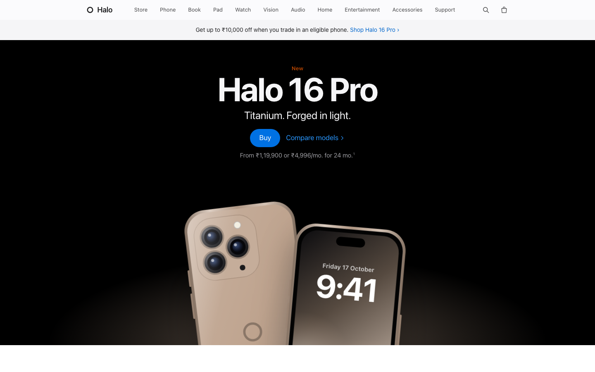
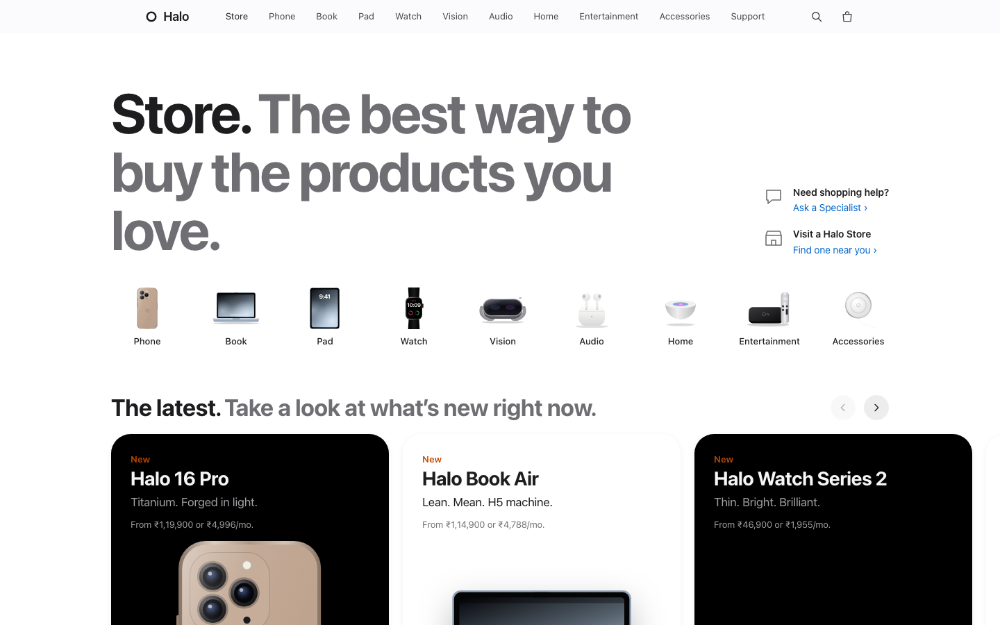
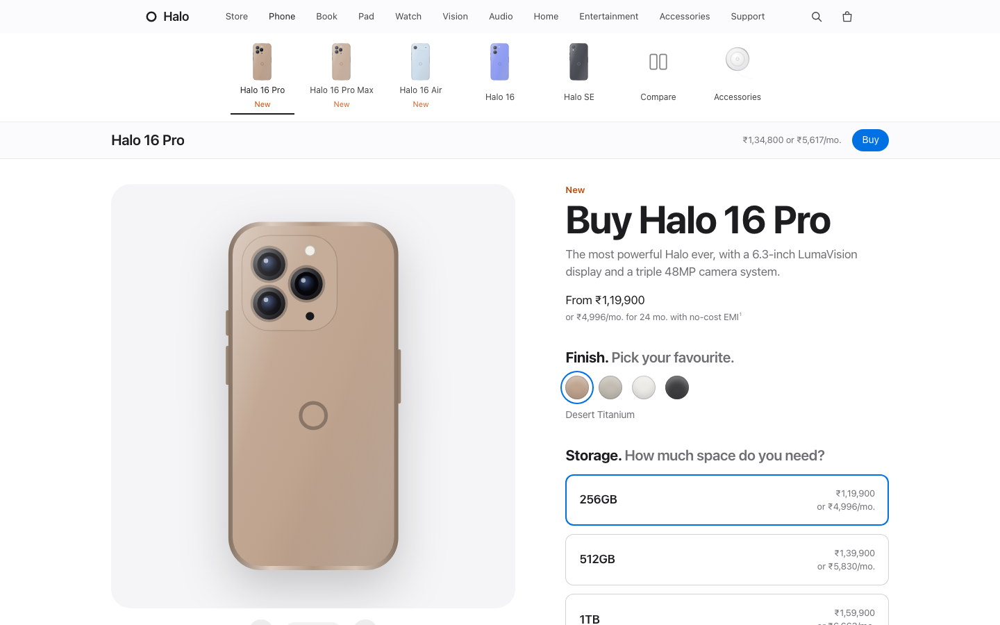
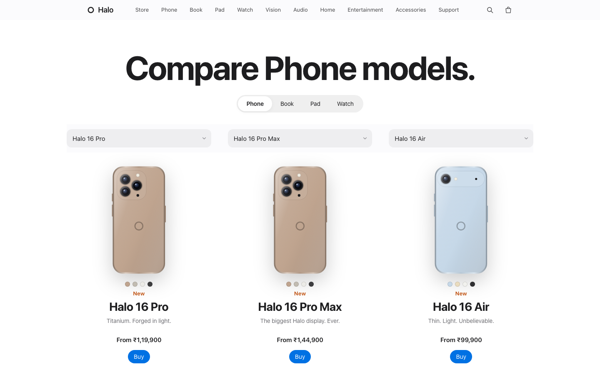

# Apple Store Clone — Halo Store

An apple.com‑style e‑commerce storefront for phones, laptops, tablets, watches, audio and accessories, built with **plain HTML, CSS and JavaScript**. No framework, no build step, no server, and no image files — every product is drawn in SVG.

The store sells products from **Halo**, a fictional brand. Halo's lineup mirrors Apple's: Phone, Book, Pad, Watch, Vision, Audio, Home, Entertainment and Accessories.



| Store | Product page |
|---|---|
|  |  |



---

## Run it

Double‑click `index.html`. That's it: the site works straight from your file system.

To host it, upload the folder to any static host:

- **GitHub Pages:** push this repo, then go to **Settings → Pages → Deploy from a branch → `main` / root**.
- **Netlify / Vercel / Cloudflare Pages:** import the repo. Leave the build command empty and set the output directory to `/`.

## Pages

| Page | What it does |
|---|---|
| `index.html` | Hero banners, product tile grid, Halo TV+ carousel, model comparison shelf, accessories and "why buy" shelves |
| `store.html` | Category icons, "The latest" and "Help is here" shelves, quick links, and every product with filters, search and sort (kept in the URL) |
| `product.html?id=…` | Model strip, swipeable gallery, finish and storage picker, trade‑in, Halo Care+, free engraving with live preview, delivery check by PIN code, save for later, sticky buy bar |
| `compare.html` | Compare up to three models side by side, with specs lined up row by row |
| `bag.html` | Bag with quantities, undo, trade‑in credit and a checkout form that checks each field as you go |
| `saves.html` | Products saved for later |
| `support.html` | Topic shortcuts and a searchable FAQ, including Halo Care+, Trade In, Education, Entertainment, Accessories and Gift Cards |
| `entertainment.html` | Halo TV+ carousel, Halo Music album shelf, Halo Arcade game shelf, and the entertainment devices; the menu's "More from Entertainment" links jump to each section |
| `legal.html` | Privacy policy, terms of use, sales policy, legal notice and a site map built from the catalogue (linked from the footer) |

## Features

**apple.com patterns**
- A translucent top bar with dropdown menus (Explore / Shop / More) that blur the page behind them
- A mobile menu you can tap into section by section
- A search panel with quick links and live results
- A bag panel that slides in from the side; drag or flick it to close
- An auto‑playing carousel with progress dots and a play/pause button
- Numbered footnotes, a breadcrumb trail, a footer that collapses on mobile, and "More ways to shop"

**Motion and feel.** Follows the [apple-design skill](https://github.com/emilkowalski/skills/blob/main/skills/apple-design/SKILL.md), which distils Apple's WWDC talk *Designing Fluid Interfaces*:
- Spring animations that can be grabbed and reversed mid‑motion
- Flicks carry their speed: the release velocity feeds the spring, and Apple's momentum projection picks where things land
- Soft, rubber‑band resistance at the edges instead of hard stops
- Buttons react the moment you press them
- Panels leave the way they came in, and popups grow out of the button that opened them

**Accessibility**
- A Light / Dark / Auto switch in the top bar (remembered per browser; Auto follows the system), plus the system's reduced motion, reduced transparency and higher contrast settings
- Keyboard support for menus, carousels and option pickers, a skip link, and screen‑reader labels on controls

**State.** The bag, saves and remembered PIN code are stored in `localStorage` (in each visitor's own browser) and stay in sync across open tabs.

## Project structure

```
├── index.html, store.html, product.html, compare.html,
│   bag.html, saves.html, support.html, entertainment.html, legal.html
├── css/styles.css     # design tokens, components, light/dark and accessibility media queries
├── js/
│   ├── data.js        # catalogue, prices, trade-in values, menus, shows, albums, games — edit this to change the store
│   ├── art.js         # SVG product illustrations
│   ├── motion.js      # spring physics, momentum projection, rubber-banding, drag helper
│   ├── app.js         # shared shell: nav, dropdowns, bag, saves, popups, toasts, footer
│   └── home.js, store.js, product.js, compare.js, bag.js, saves.js, support.js, entertainment.js, legal.js
├── docs/screenshots/
└── favicon.svg
```

## Customise

Everything the store shows comes from [`js/data.js`](js/data.js). Add a product to `PRODUCTS` and it appears in the store, search, menus, compare page and footer automatically.

```js
{
  id: 'halo-17', name: 'Halo 17', category: 'phones', art: 'phone', variant: 'standard',
  tagline: 'Hello, colour.', blurb: '…', price: 84900,
  colors: [{ name: 'Teal', hex: '#8fc7bf' }],
  storage: [{ label: '128GB', add: 0 }, { label: '256GB', add: 10000 }],
  specs: [['Display', '6.1″ OLED'], ['Chip', 'H6']]
}
```

## Disclaimer

This is a **design study and portfolio project**, not a real shop. No orders are placed and no payment is collected; checkout ends at a demo confirmation.

"Halo" and all product names are fictional. The project is **not affiliated with, endorsed by, or sponsored by Apple Inc.** It imitates the general layout and interaction patterns of apple.com for learning purposes only. It uses no Apple logos, product images or assets. Apple, iPhone, Mac, iPad and apple.com are trademarks of Apple Inc.

